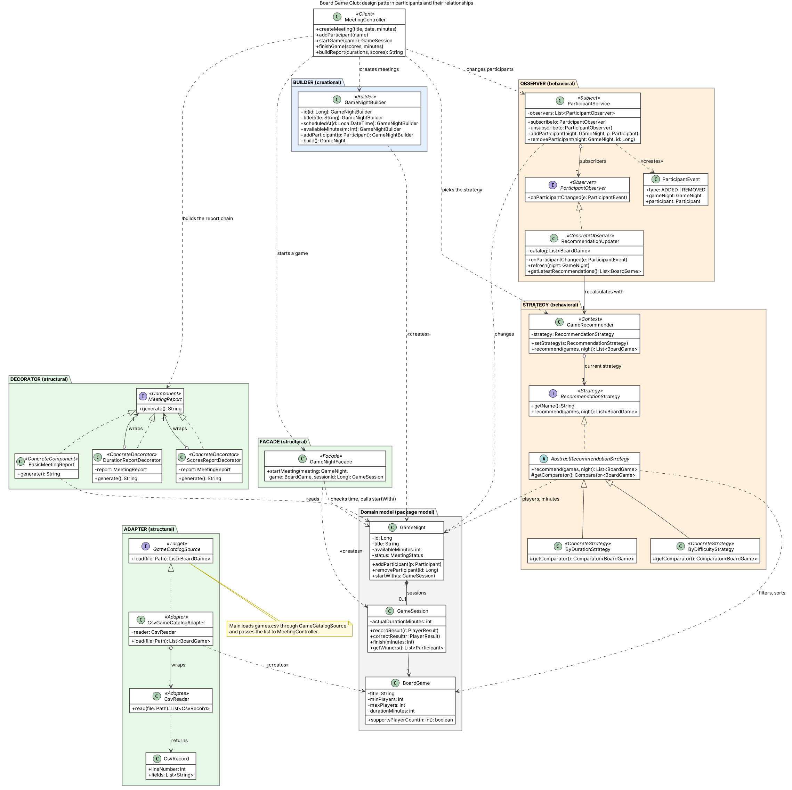
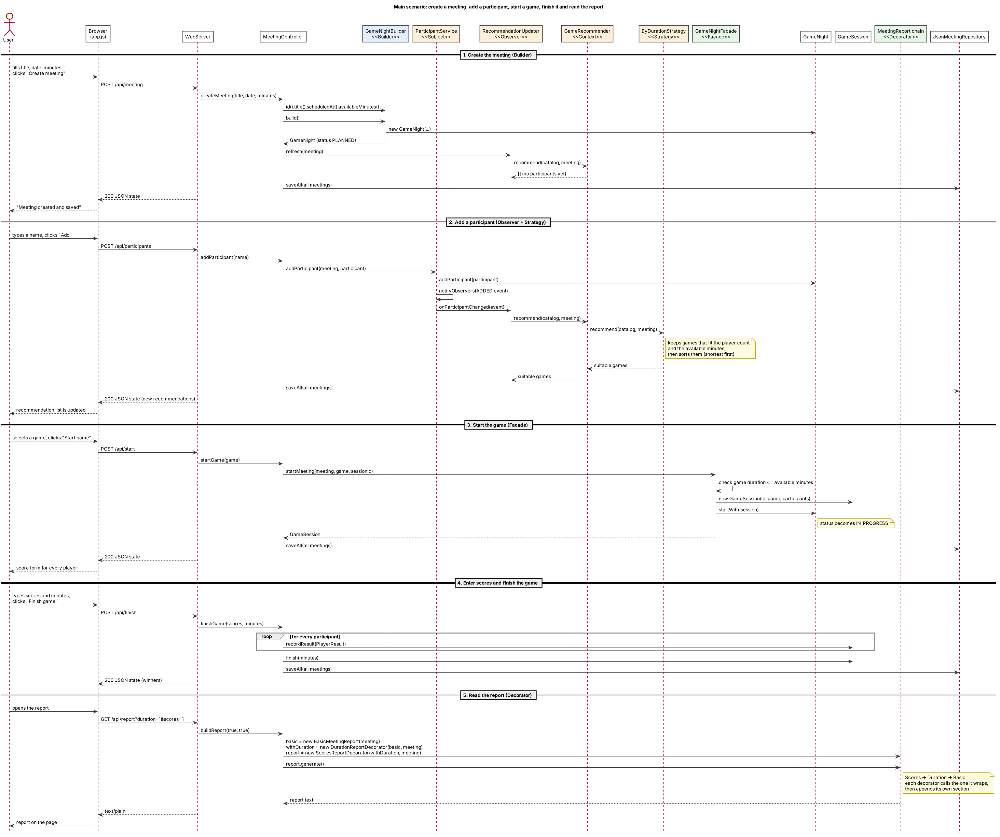

# Board Game Club

A web application for planning board game nights. You create a meeting, add the people who come, see which games fit the group and the time you have, start a game, record the scores and read a report. Meetings and scores are saved to a file and are still there after you restart the application.

The logic is written in Java and the interface is a web page (HTML, CSS and JavaScript) that the application serves on your own computer.

The project was built for the *Software Design Patterns* course. It integrates six patterns in one application: Builder, Facade, Decorator, Adapter, Strategy and Observer (see [Design patterns](#design-patterns)).

## Contents

1. [Requirements](#requirements)
2. [Setup and launch](#setup-and-launch)
3. [Sample data](#sample-data)
4. [How to check the application](#how-to-check-the-application)
5. [Automated tests](#automated-tests)
6. [Design patterns](#design-patterns)
7. [Diagrams](#diagrams)
8. [Architecture and project structure](#architecture-and-project-structure)
9. [Known limitations](#known-limitations)
10. [Troubleshooting](#troubleshooting)

## Requirements

| What | Version | Notes |
|---|---|---|
| JDK | 25 | `pom.xml` compiles for Java 25. Check with `java -version`. |
| Apache Maven | 3.9 or newer | Check with `mvn -v`. Maven must use the same JDK 25. |
| Web browser | any current one | Chrome, Edge or Firefox. |
| Internet connection | first build only | Maven downloads Gson and JUnit once. |

No database and no other software is needed.

## Setup and launch

**1. Get the code**

```
git clone https://github.com/jostartir/BoardGame-Club.git
cd BoardGame-Club
```

Or unzip the submitted archive and open a terminal in the extracted folder (the one that contains `pom.xml`).

**2. Build and run the tests**

```
mvn clean test
```

The build should finish with `BUILD SUCCESS`.

**3. Start the application**

Always start it from the project root (the folder with `pom.xml`, `games.csv` and `data/`), because the game list and the saved meetings are found by relative path.

*Option A, IntelliJ IDEA:* open the folder as a Maven project, set the project SDK to JDK 25, open `src/main/java/Main.java` and press Run. Leave the working directory as the project root, which is the default.

*Option B, command line:*

```
mvn compile exec:java "-Dexec.mainClass=Main"
```

The console prints:

```
Loaded 3 games from games.csv
Loaded N saved meetings from data/meetings.json
Board Game Club is running at http://localhost:8080/
```

Your browser may open by itself. If not, open <http://localhost:8080/>. Stop the application with `Ctrl+C` in the terminal.

**Optional arguments:** `Main [games-file] [data-file]`. The defaults are `games.csv` and `data/meetings.json`. The port is 8080 and the server accepts connections from this computer only.

## Sample data

### `games.csv`: the game catalog

The application reads the game list from this file through the Adapter pattern. The first line is a header. Each following line is one game.

```
id,title,minPlayers,maxPlayers,durationMinutes,difficulty,genre
1,Uno,2,10,20,1,Card
2,Monopoly,2,8,120,2,Family
3,Chess,2,2,60,3,Abstract
```

| Column | Rule |
|---|---|
| `id` | positive whole number, unique |
| `title`, `genre` | not empty (use double quotes if the text contains a comma) |
| `minPlayers`, `maxPlayers` | `minPlayers` is at least 1, `maxPlayers` is not less than `minPlayers` |
| `durationMinutes` | greater than 0 |
| `difficulty` | from 1 to 5 |

To add a game, add a line. A bad line stops the start-up with a message that names the line number, for example `Line 3: expected 7 columns but found 5`.

### `data/meetings.json`: saved meetings

The repository includes a file with sample meetings: planned meetings with participants, and one meeting with a finished Uno game and its scores. They appear in the **Saved meetings** list as soon as the application starts.

The application rewrites this file after every change (new meeting, participants, game start, score, finish). It is a normal JSON file, but do not edit it while the application is running.

To start from an empty state, stop the application and replace the content of `data/meetings.json` with `[]`. If the file is missing, the application starts empty and creates it on the first save.

## How to check the application

Start the application and open <http://localhost:8080/>. The italic note in brackets after a step names the pattern or feature that step shows.

### A. Catalog

1. The **Game catalog** section shows three cards (Uno, Monopoly, Chess) with duration, difficulty and a row of squares for the supported player counts. *(Adapter: the list comes from `games.csv`.)*
2. The **Saved meetings** list shows the sample meetings from `data/meetings.json`. Click the one with a finished Uno game. The results, the winner and the report appear. *(Loading saved data.)*

### B. Main user journey

1. In **Meeting** enter the title `Friday game night`, keep the date, set `120` minutes and click **Create meeting**. The message says the meeting was created and saved, and it appears in **Saved meetings**. *(Builder.)*
2. Add `Alikhan` and `Daniyar`. The recommendations show **Uno, Chess, Monopoly**. *(Observer and Strategy.)*
3. Add `Aigerim` as a third participant. Chess disappears from the recommendations, because it is for exactly two players. Remove Aigerim again and Chess comes back. *(Observer: the list updates after every change.)*
4. Switch the order to **By difficulty**. The order becomes Uno, Monopoly, Chess. Switch back to **By duration**. *(Strategy: two interchangeable algorithms.)*
5. Select **Chess** and click **Start game**. A panel with a score field for each player appears, the meeting is in progress, and the participant controls are locked. *(Facade.)*
6. Type `10` for Alikhan and click **Save score**. Saving a score does not finish the game.
7. **Restart check:** stop the application with `Ctrl+C`, start it again, open the meeting from **Saved meetings**. The game is still running and Alikhan's field shows `10`. *(Persistent storage.)*
8. Change Alikhan's score to `15` and click **Save score**. The score is replaced, not duplicated. Type `12` for Daniyar, set `Minutes played` to `40` and click **Finish game**. The results show Alikhan as the winner with 15.
9. Click **Fix scores**, change Alikhan's score to `20` and click **Save score**. The result and the winner are updated and the game stays finished with 40 minutes. Click **Done**.
10. In **Meeting report** switch the two checkboxes on and off. The sections for playing time and scores appear and disappear. *(Decorator.)*
11. Click **Download report**. The file `meeting-report.txt` contains `Alikhan: 20` and `Daniyar: 12`.
12. Restart the application again and open the meeting. The finished game, the duration and the score `20` are still there.

### C. Validation and errors

Each of these shows a red message, and the meeting stays as it was

| Action | Message |
|---|---|
| Create a meeting with an empty title | `Meeting title must not be blank` |
| Create a meeting with minutes `abc` | `Available minutes must be a whole number, for example 120` |
| Create a meeting with minutes `0` or `-5` | `Available time must be greater than zero` |
| Add a participant with an empty name | `Participant name must not be blank` |
| Add a name that is already in the meeting | `A participant named ... is already in the meeting` |
| Finish a game while a player has no score | `Enter a score for ...` |
| Enter `abc` as a score | `Score for ... must be a whole number` |
| Finish a game with `0` minutes played | `Actual duration must be greater than zero` |

**Boundary case** create a meeting with `30` minutes and add two people. Only Uno is recommended, because Chess (60 minutes) and Monopoly (120 minutes) do not fit.

### D. Optional: look at the data the page uses

While the application is running, <http://localhost:8080/api/state> shows the current meeting, participants and recommendations as JSON. <http://localhost:8080/api/games> shows the catalog.

## Automated tests

```
mvn test
```

This runs 57 tests in 8 test classes

| Test class | Tests | What it covers |
|---|---|---|
| `GameNightBuilderTest` | 3 | Builder settings, default time, duplicate participants |
| `GameNightFacadeTest` | 3 | Starting a game, game too long, too few players |
| `MeetingReportDecoratorTest` | 2 | Combined report, corrected score in the report |
| `CsvGameCatalogAdapterTest` | 8 | Reading the CSV, quoted titles, error messages with line numbers |
| `RecommendationStrategyTest` | 5 | Both orders, filtering, empty result |
| `ParticipantObserverTest` | 7 | Notifications on add and remove, no notification on errors |
| `MeetingControllerTest` | 21 | The whole journey, scores, corrections, saving and reloading |
| `WebServerTest` | 8 | The HTTP interface end to end |

## Design patterns

| Pattern | Category | Main classes | Where you see it |
|---|---|---|---|
| Builder | Creational | `GameNightBuilder` | Creating a meeting from the form |
| Facade | Structural | `GameNightFacade` | The **Start game** button. One call checks the time, creates the session and starts the meeting |
| Decorator | Structural | `MeetingReport`, `BasicMeetingReport`, `DurationReportDecorator`, `ScoresReportDecorator` | The report and its two checkboxes |
| Adapter | Structural | `GameCatalogSource`, `CsvGameCatalogAdapter`, `CsvReader` | The catalog loaded from `games.csv` |
| Strategy | Behavioral | `RecommendationStrategy`, `ByDurationStrategy`, `ByDifficultyStrategy`, `GameRecommender` | The **By duration / By difficulty** switch |
| Observer | Behavioral | `ParticipantService`, `ParticipantObserver`, `RecommendationUpdater`, `ParticipantEvent` | The recommendations that change when people join or leave |

`MeetingController` is where the patterns are combined.

## Diagrams

| Diagram | Source | Image |
|---|---|---|
| The participants of all six patterns and how they relate | [`docs/class-diagram.puml`](docs/class-diagram.puml) | [`docs/class-diagram.png`](docs/class-diagram.png) |
| Create a meeting, add a participant, start a game, finish it, read the report | [`docs/sequence-diagram.puml`](docs/sequence-diagram.puml) | [`docs/sequence-diagram.png`](docs/sequence-diagram.png) |





## Architecture and project structure

```
Browser (HTML, CSS, JavaScript)
        |  JSON over HTTP
WebServer  (JDK HttpServer, no framework)
        |
MeetingController  -------------------------+
        |                                    |
Domain model and patterns            JsonMeetingRepository (Gson)
(model, builder, facade,                     |
 decorator, strategy, observer)       data/meetings.json
        ^
        |
Adapter  <--  games.csv
```

The interface, the business logic and the storage are separate. The page only talks to `WebServer`, `WebServer` only talks to `MeetingController`, and only `JsonMeetingRepository` touches the data file.

```
BoardGame-Club/
├── pom.xml
├── README.md
├── games.csv                         game catalog (sample data)
├── data/
│   └── meetings.json                 saved meetings (sample data, rewritten by the app)
├── docs/
│   ├── class-diagram.puml / .png
│   └── sequence-diagram.puml / .png
└── src/
    ├── main/
    │   ├── java/
    │   │   ├── Main.java             start-up: catalog, saved meetings, web server
    │   │   ├── app/                  MeetingController
    │   │   ├── web/                  WebServer, Json
    │   │   ├── storage/              JsonMeetingRepository
    │   │   ├── model/                GameNight, GameSession, BoardGame, Participant, PlayerResult, MeetingStatus
    │   │   ├── builder/              Builder
    │   │   ├── facade/               Facade
    │   │   ├── decorator/            Decorator
    │   │   ├── adapter/              Adapter
    │   │   ├── strategy/             Strategy
    │   │   └── observer/             Observer
    │   └── resources/web/            index.html, style.css, app.js
    └── test/java/                    tests, one folder per package
```

### HTTP interface (used by the page)

| Request | What it does |
|---|---|
| `GET /api/games` | the game catalog |
| `GET /api/state` | the current meeting, participants, recommendations and saved meetings |
| `POST /api/meeting` | create a meeting (`title`, `date`, `minutes`) |
| `POST /api/meetings/select` | open a saved meeting (`id`) |
| `POST /api/participants` | add a participant (`name`) |
| `DELETE /api/participants/{id}` | remove a participant |
| `POST /api/strategy` | choose the recommendation order (`id`) |
| `POST /api/start` | start a game (`gameId`) |
| `POST /api/scores` | save one score, the game stays open (`participantId`, `score`) |
| `POST /api/finish` | finish the game (`minutes` and `score_<id>` fields) |
| `POST /api/scores/correct` | fix a score of a finished game (`participantId`, `score`) |
| `GET /api/report` | the report text (`duration=1`, `scores=1` choose the sections) |

## Known limitations

- A meeting has one game. After you finish it, create a new meeting to play again
- Participants and the chosen game cannot be changed after the game has started. Scores can be corrected
- There is no button to delete a meeting. To remove one, edit `data/meetings.json` while the application is stopped
- The application is for one user on one computer: it has no login and listens on `localhost` only
- `data/meetings.json` is written as a whole file on every change, so run only one copy of the application at a time

## Troubleshooting

| Problem | Cause and fix |
|---|---|
| `Cannot load game catalog from games.csv` | The application was started from another folder, or a line in the CSV is wrong. Start it from the project root and read the line number in the message. |
| `Cannot load meetings from ...` and the application stops | `data/meetings.json` is not valid. The application refuses to start so that it does not overwrite your data. Fix the file or replace it with `[]`. |
| `Cannot start the web server on port 8080` | Another program uses the port. Close the other copy of the application. |
| The page shows `Not found` | `index.html`, `style.css` and `app.js` must be in `src/main/resources/web/`. Rebuild with `mvn clean compile`. |
| Maven says `invalid target release: 25` | Maven is using an older JDK. Install JDK 25 and check that `mvn -v` shows it. |
| The page says `Cannot reach the server` | The application was stopped. Start it again. |
